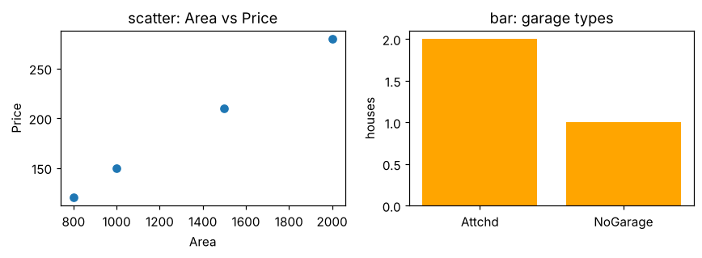
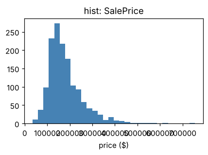
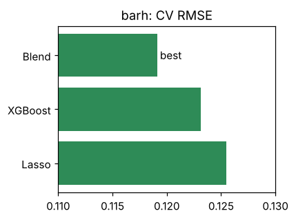

# Part 0：基礎知識（Part 1–5 都會用到）

> **點用呢份筆記：** 每一個概念都會跟住咁嘅次序講：
> 1. 一句講佢係咩；
> 2. 一段好短嘅 code（大部份用真實樓價數據）；
> 3. **「跑出嚟會見到」**：呢段 code 真正跑出嚟嘅結果；
> 4. 逐樣解釋個結果點睇。
>
> 你可以喺 Kaggle notebook 開一格新 cell，自己貼段 code 落去跑，對下個結果係咪一樣。唔使一次讀晒，Part 1–5 遇到唔識嘅嘢，佢哋會寫「→ Part 0 §X」，到時返嚟查就得。
>
> **編號說明：** 筆記入面用「§」嘅編號（例如「Part 1 §1.5」）係指**筆記**嘅章節。notebook 入面嘅英文小標題（例如「1.4 Outliers」）係另一套編號。筆記提到 notebook 嘅格時會寫「Cell 5」。

---

## §1 Python 基本

### §1.1 變數（variable）

**一句講晒：** 變數就係一個「名」，用嚟裝住一個值，等你之後可以用個名叫返個值出嚟。

```python
price = 180000
name = "Ridge"
price_in_thousands = price / 1000
print(price)
print(name)
print(price_in_thousands)
```

跑出嚟會見到：

```text
180000
Ridge
180.0
```

**點睇：**
- `price = 180000`：將 180000 呢個數放入一個叫 `price` 嘅名度。`=` 唔係數學嘅「相等」，而係「**放入**」。
- `"Ridge"`：有引號嘅係**文字**（叫 string）；冇引號嘅 180000 係數字。
- `price / 1000`：用個名做計算，等於 180000 ÷ 1000。
- `print(...)`：將括號入面嘅嘢顯示喺畫面。

### §1.2 幾種常見嘅「容器」：list、tuple、dict、set

成日要裝**一堆**值，Python 有 4 種常用容器：

```python
alphas = [1, 3, 10, 30]                       # list：有次序嘅一串
rule = ("GarageArea", "NoGarage")             # tuple：打包幾樣相關嘅嘢
alpha_scores = {1: 0.130, 3: 0.128, 10: 0.1277}   # dict：用 key 查 value
feature_steps = {"2", "3", "4"}               # set：冇次序、冇重複
print(alphas[0], alphas[-1])
print(rule[1])
print(alpha_scores[10])
print("3" in feature_steps, "7" in feature_steps)
```

跑出嚟會見到：

```text
1 30
NoGarage
0.1277
True False
```

**點睇：**
- `alphas[0]` 攞**第一個**（位置由 0 開始數！），所以係 1；`alphas[-1]` 攞**最後一個**，係 30。
- `rule[1]` 係 tuple 入面第二樣嘢，即係 "NoGarage"。tuple 同 list 差唔多，分別係 tuple 建立咗之後唔可以改。
- `alpha_scores[10]`：dict 唔係用位置，而係用 **key** 去查。key 10 對應嘅 value 係 0.1277。好似查字典：查「10」呢個字，就見到佢嘅解釋。
- `"3" in feature_steps`：問「"3" 喺唔喺個 set 入面？」，係就 True，唔係就 False。
- 分辨方法：`[ ]` 係 list，`( )` 係 tuple，`{a: b}`（有冒號）係 dict，`{a, b}`（冇冒號）係 set。

**Slicing（切片）：攞一段出嚟**

```python
a = [10, 20, 30, 40]
print(a[1:3])    # 第 1 至第 2 個（唔包第 3 個）
print(a[:2])     # 由頭到第 1 個
print(a[:-1])    # 除咗最後一個
print(a[::-1])   # 倒轉
```

跑出嚟會見到：

```text
[20, 30]
[10, 20]
[10, 20, 30]
[40, 30, 20, 10]
```

**點睇：** `[開始:結束]` 包「開始」但**唔包「結束」**，所以 `a[1:3]` 係位置 1 同 2，即係 20、30。`[::-1]` 嘅 -1 代表「一步步倒行」，所以成個倒轉。之後畫橫棒圖時會成日用 `[::-1]`，令最大嘅排最上面。

### §1.3 Function（函數）

**一句講晒：** function 就係將一段做法包起嚟、改個名，之後一句就可以叫佢做成段嘢。

```python
def add_fee(price, fee=5000):
    """Return the price plus an agent fee."""
    return price + fee

print(add_fee(180000))
print(add_fee(180000, fee=8000))
```

跑出嚟會見到：

```text
185000
188000
```

**逐行點睇：**
- `def add_fee(price, fee=5000):`
  - `def` 代表「定義一個 function」，個名叫 `add_fee`。
  - 括號入面係**參數**，即係 function 嘅輸入。
  - `fee=5000` 係**預設值**：冇講就用 5000。
- `"""..."""`：三個引號包住嘅叫 **docstring**，只係俾人睇嘅說明，Python 唔會執行。
- `return ...`：將計好嘅結果「交返出去」。
- **縮排**（行頭 4 個空格）好重要：Python 靠佢分邊幾行屬於呢個 function。
- `add_fee(180000)`：冇講 fee，用預設 5000，得 185000。
- `add_fee(180000, fee=8000)`：講明 fee=8000，得 188000。呢種「名=值」嘅寫法叫 **keyword argument**。

**喺我哋嘅 project：** `cv_evaluate(model, X, y, X_test, target="log", drop_outliers=False)` 都係咁。平時唔講就係 `target="log"`、`drop_outliers=False`；Step 0、1 寫 `target="raw"`，Step 6 開始寫 `drop_outliers=True`。

**點解要寫 function？** 同一套步驟要對 train 同 test 各做一次。寫一次、用兩次，就保證兩邊做法一模一樣。

**Lambda：一行、冇名嘅 function**

```python
make_double = lambda a: a * 2
print(make_double(5))
```

跑出嚟會見到：

```text
10
```

`lambda a: a * 2` 等於：

```python
def make_double(a):
    return a * 2
```

只係寫成一行。當你要「將一個做法交俾另一個 function 用」時就好方便。Part 4 嘅 `tune_alpha(lambda a: Lasso(alpha=a), ...)` 就係將「俾我一個 alpha，我整一個 Lasso」呢個做法交俾 `tune_alpha`。

### §1.4 `for` 迴圈：逐個做一次

```python
for alpha in [1, 3, 10]:
    print("trying alpha =", alpha)
```

跑出嚟會見到：

```text
trying alpha = 1
trying alpha = 3
trying alpha = 10
```

**點睇：** 由 list 逐個攞出嚟，每次放入 `alpha`，然後做一次縮排入面嘅嘢。list 有 3 個，所以做 3 次。

**一次拆幾個值（unpacking）**

```python
rules = [("GarageArea", "NoGarage"), ("PoolArea", "NoPool")]
for size_column, label in rules:
    print(size_column, "->", label)
```

跑出嚟會見到：

```text
GarageArea -> NoGarage
PoolArea -> NoPool
```

**點睇：** `rules` 每一項都係一個有 2 樣嘢嘅 tuple。`for size_column, label in rules` 每次會自動將嗰 2 樣分別放入 `size_column` 同 `label` 兩個變數。Part 3 嘅 `ABSENT_RULES` 每項有 3 樣嘢，原理一樣。

**`enumerate`：一路行一路俾埋位置**

```python
for i, score in enumerate([0.155, 0.152, 0.151]):
    print(i, score)
```

跑出嚟會見到：

```text
0 0.155
1 0.152
2 0.151
```

**點睇：** `i` 係位置（0, 1, 2），`score` 係值。Part 5 畫圖時用佢喺每條棒頂寫分數。

**兩層 for**

```python
for C in [1, 10]:
    for gamma in [0.001, 0.003]:
        print("C =", C, "gamma =", gamma)
```

跑出嚟會見到：

```text
C = 1 gamma = 0.001
C = 1 gamma = 0.003
C = 10 gamma = 0.001
C = 10 gamma = 0.003
```

**點睇：** 外層每行一次，內層就行晒一輪，所以總共 2 × 2 = 4 次。Part 4 嘅 SVR grid search 就係咁試晒所有組合。

### §1.5 `if` / `else`：揀做邊樣

```python
target = "log"
if target == "log":
    print("learn log prices")
else:
    print("learn raw prices")
```

跑出嚟會見到：

```text
learn log prices
```

**點睇：**
- `==`（兩個等號）係**問**「係咪相等？」，結果係 True 或 False。
- 一個 `=` 係 §1.1 嘅「放入」，唔好撈亂。
- 條件成立就做 `if` 下面嗰段，否則做 `else` 下面嗰段。

### §1.6 Method（方法）同 `.`

**一句講晒：** `東西.動作()`，即係叫呢樣東西做某個動作。

```python
word = "nogarage"
print(word.upper())
print(word.upper().replace("NO", "NO_"))
```

跑出嚟會見到：

```text
NOGARAGE
NO_GARAGE
```

**點睇：** `word.upper()` 叫個字串變大楷。method 可以一路串落去，**由左至右**逐個做：先變大楷，再將 "NO" 換成 "NO_"。之後 `train.isna().sum()` 都係咁讀：先 `isna()`，再 `sum()`。

### §1.7 其他常見寫法（逐個示範）

呢度啲寫法好細粒，但 Part 1–6 成日用。逐個睇一次佢哋做咗咩。

**① 註解 `#` 同 `+=`**

```python
total = 0        # 「#」後面係註解：Python 當冇見到，係寫俾人睇嘅
total += 5       # 即係 total = total + 5，而家係 5
total += 3       # 再加 3，而家係 8
print(total)
```

跑出嚟會見到：

```text
8
```

**點睇：** `#` 後面嘅字唔會執行，用嚟解釋 code。`total += 5` 係「喺原本嘅數上面加 5」嘅簡寫。

**② `len` 同 `range`**

```python
prices = [200, 150, 300]
print(len(prices))            # 有幾多個
print(list(range(3)))         # 0, 1, 2（由 0 開始，唔包 3）
for i in range(len(prices)):
    print("house", i, "costs", prices[i])
```

跑出嚟會見到：

```text
3
[0, 1, 2]
house 0 costs 200
house 1 costs 150
house 2 costs 300
```

**點睇：**
- `len(prices)` 數有幾多個：3。用喺 DataFrame 就係數有幾多行。
- `range(3)` 會產生 0、1、2，最常配 for 用：「做 3 次，每次俾我個編號」。

**③ `None`：Python 嘅「冇嘢」**

```python
answer = None
print(answer)
print(answer is None)
```

跑出嚟會見到：

```text
None
True
```

**點睇：** `None` 好似一個吉嘅盒，代表「呢度冇值」。`is None` 用嚟問「係咪吉嘅？」。Part 1 用 `next(…, None)`：搵唔到 data 就俾 `None`；Part 4 用 `step=None` 代表「唔使記錄入成績表」。

**④ `_`：「呢個值我唔要」**

```python
def three_results():
    return 0.155, "OOF predictions", "test predictions"

score, _, _ = three_results()
print(score)
```

跑出嚟會見到：

```text
0.155
```

**點睇：** function 一次過交返 3 樣嘢，但我只想要第一樣。用 `_` 接住其餘兩樣，意思係「呢兩個我唔要」。`cv_evaluate` 回傳 3 樣嘢，所以成日見到 `score, _, _ = cv_evaluate(...)`。

**⑤ `assert`：安全檢查**

```python
rows = 1459
assert rows == 1459      # 條件啱：靜靜雞通過，乜都唔印
print("check passed")
```

跑出嚟會見到：

```text
check passed
```

如果條件唔啱（例如 `rows` 係 1458），程式會即刻停低，顯示：

```text
AssertionError
```

**點睇：** 好似機場安檢：冇問題就直接放行；有問題就即刻截停。`save_submission` 用佢喺交 Kaggle 之前檢查行數同價錢，寧願 notebook 停低，都唔好交一個錯嘅檔案。

**⑥ `global`：喺 function 入面改外面嘅變數**

```python
counter = 0

def add_one():
    global counter        # 話俾 Python 聽：我要改嘅係外面嗰個 counter
    counter = counter + 1

add_one()
add_one()
print(counter)
```

跑出嚟會見到：

```text
2
```

**點睇：** 平時 function 入面改嘢，唔會影響外面。加咗 `global counter`，就會改到外面嗰個，所以叫兩次之後變咗 2。Part 2 嘅 `record` 用 `global results`，每次記錄都改到成個 notebook 共用嗰張成績表。

**⑦ `import`：由工具箱攞工具**

```python
import numpy as np                         # 攞成個 numpy 工具箱，之後叫佢做 np
from sklearn.linear_model import Ridge     # 只係由 sklearn 個箱攞 Ridge 呢件工具出嚟
```

Python 本身好細，好多功能放喺「套件（package）」入面，要用就要先 `import`。`np`、`pd`、`plt` 呢啲短名係大家約定俗成嘅叫法。

**⑧ f-string：將數字塞入文字，仲可以控制格式**

```python
score = 0.1276559
change = -0.0047304
seconds = 82.7
print(f"CV RMSE {score:.5f}")
print(f"change {change:+.5f}")
print(f"took {seconds:.0f} s")
print(f"alpha={3:>3}|")
print(f"alpha={100:>3}|")
```

跑出嚟會見到：

```text
CV RMSE 0.12766
change -0.00473
took 83 s
alpha=  3|
alpha=100|
```

**點睇：**
- 字串前面加 `f`，`{ }` 入面嘅嘢就會被換成真正嘅值。
- `:.5f`：5 個小數位。
- `:+.5f`：5 個小數位，**一定顯示正負號**。`record` 用呢個，所以你會見到 `+0.00014` 或者 `-0.01882`。
- `:.0f`：唔要小數（82.7 → 83，會四捨五入）。
- `:>3`：靠右、佔 3 格，令幾行嘅數字對齊（留意 3 前面多咗兩個空格）。

### §1.8 縮短咗嘅 for：comprehension 同一行 if

呢幾種寫法本質上都係 for 迴圈或者 if，只係寫成一行。睇到唔好驚，拆返做普通 for 就明。

**List comprehension**

```python
prices = [100000, 200000, 400000]
doubled = [p * 2 for p in prices]
cheap = [p for p in prices if p < 300000]
print(doubled)
print(cheap)
```

跑出嚟會見到：

```text
[200000, 400000, 800000]
[100000, 200000]
```

**點睇：** `[p * 2 for p in prices]` 讀法係「對 prices 入面每個 p，計 p × 2，全部放入一個新 list」。加 `if` 就只保留條件成立嘅。佢等於：

```python
doubled = []
for p in prices:
    doubled.append(p * 2)
```

**Dict comprehension**

```python
names = ["xgb", "svr"]
{name: len(name) for name in names}
```

跑出嚟會見到：

```text
{'xgb': 3, 'svr': 3}
```

**點睇：** 同上面一樣，只係結果係 dict：`key: value`。Part 5 嘅 `{name: y_log - oof[name] for name in names}` 就係「每個 model 名 → 佢嘅錯誤」。

**`next(...)`：攞第一個符合條件嘅**

```python
folders = ["/kaggle/input/abc", "../data", "data"]
exists = {"../data"}                          # pretend only this one exists
print(next((f for f in folders if f in exists), None))
print(next((f for f in folders if f == "nowhere"), None))
```

跑出嚟會見到：

```text
../data
None
```

**點睇：** 括號入面嗰段叫 generator expression，佢會逐個試，搵到第一個符合條件嘅就停，所以第一行印 `../data`。`next(…, None)` 嘅 `None` 係「一個都搵唔到」時嘅預設值，所以第二行印 `None`。Part 1 用呢個方法搵 data 放咗喺邊。

**一行 if：`A if 條件 else B`**

```python
value = 0.99
color = "white" if value > 0.93 else "black"
print(color)
```

跑出嚟會見到：

```text
white
```

**點睇：** 條件成立就係 A（"white"），否則係 B。Part 5 熱力圖就用呢個決定字嘅顏色。

---

## §2 NumPy（`np`）：一次過計一大堆數

### §2.1 Array 同向量化計算

```python
import numpy as np
prices = np.array([100000, 200000, 400000])
print(prices * 2)
print(np.log(prices))
```

跑出嚟會見到：

```text
[200000 400000 800000]
[11.51292546 12.20607265 12.89921983]
```

**點睇：** numpy array 好似 list，但可以**一次過計晒每一個**，唔使寫 for：`prices * 2` 每個都乘 2。好似喺 Excel 寫一條公式，再成欄拉落去。`np.log(prices)` 每個都取 log。呢個叫**向量化（vectorization）**，又快又短。

### §2.2 常用 function

```python
x = np.array([0, 100, 10000])
print(np.log1p(x))
print(np.exp(np.log(180000)).round(2))
print(np.clip(np.array([-5, 50, 500]), 10, None))
print(np.where(np.array([3, 8, 1]) > 2, "big", "small"))
print(np.mean([100, 200, 300]), np.sqrt(16))
```

跑出嚟會見到：

```text
[0.         4.61512052 9.21044037]
180000.0
[ 10  50 500]
['big' 'big' 'small']
200.0 4.0
```

**逐行點睇：**
- `np.log1p(x)`：即係 log(1 + x)。0 → 0（如果用 `np.log(0)` 就會變負無限大，爆）。詳細 → §5.4。
- `np.exp(np.log(180000))`：exp 係 log 嘅反向，所以行一轉又變返 180000。我哋就係用 `np.exp` 將預測嘅 log 價錢變返做價錢。
- `np.clip(…, 10, None)`：細過 10 嘅當 10，`None` 即係冇上限。所以 -5 → 10。
- `np.where(條件, A, B)`：條件成立揀 A，否則揀 B，逐個做。
- `np.mean` 平均、`np.sqrt` 開方。
- 輸出入面數字後面嘅 `.`（例如 `4.`）只係代表「呢個係小數類型」，`4.` 即係 4.0。
- 小貼士：電腦計小數會有極細嘅誤差，例如 0.1 + 0.2 會得 0.30000000000000004。見到呢類長尾數唔使驚，用 `.round(2)` 就會變靚。

### §2.3 Boolean mask：用 True/False 揀出你要嘅

```python
price = np.array([100, 500, 200])
area = np.array([900, 5000, 1200])
big = area > 4000
print(big)
print(price[big])
print(price[~big])
print((area > 1000) & (price < 300))
```

跑出嚟會見到：

```text
[False  True False]
[500]
[100 200]
[False False  True]
```

**點睇：**
- `area > 4000` 逐個比較，得出一串 True/False，叫 **boolean mask**（好似一塊有窿嘅膠片，True 嘅位置先透光）。
- `price[big]`：用塊膠片揀，只要 True 嘅位置，所以得 500。
- `~big`：`~` 係「反轉」，True 變 False，所以揀返其他兩個。
- `&` 係「同埋」（兩個都要成立），`|` 係「或者」。每個條件**一定要加括號**。Part 1 搵 outlier 就係用 `(面積 > 4000) & (價錢 < 300000)`。

---

## §3 pandas（`pd`）：處理表格

> 可以將 pandas 當成**「用 code 去玩 Excel」**。淨係睇文字好難想像，所以下面先整一張**得 3 間屋嘅迷你假表 `df`**，逐個 method 睇佢變出嚟係咩樣。最後先用返真數據。

```python
import numpy as np
import pandas as pd

df = pd.DataFrame({
    "Area":   [1000, np.nan, 1500],              # 面積：第 1 間唔知（缺失）
    "Price":  [200, 150, 300],                   # 價錢（千蚊）
    "Garage": ["Attchd", "NoGarage", "Attchd"],  # 車房類型（文字）
    "Age":    [5, -1, 30],                       # 樓齡：-1 係錯誤數據
})
df
```

跑出嚟會見到：

```text
     Area  Price    Garage  Age
0  1000.0    200    Attchd    5
1     NaN    150  NoGarage   -1
2  1500.0    300    Attchd   30
```

**點睇：**
- 一張表有 3 行（3 間屋）、4 欄（4 個特徵）。
- 最左邊嘅 0、1、2 **唔係數據**，而係每行嘅「名」，叫 **index**。
- `NaN` 係空格（缺失），之後會示範點處理。
- 樓齡 −1 冇可能，係故意放落去嘅「錯誤數據」，之後會示範點樣執靚佢。

### §3.1 DataFrame、Series、index、NaN

**DataFrame 同 Series：** 成張表叫 **DataFrame**；入面**單獨一條直欄**叫 **Series**。

```python
df["Price"]
```

跑出嚟會見到：

```text
0    200
1    150
2    300
Name: Price, dtype: int64
```

**點睇：** 攞一欄出嚟就係一條 Series：左邊仍然係 index（0、1、2），右邊係數值，最底話你知欄名（Name）同資料類型（dtype：int64 即係整數）。

**Index 唔一定係 0、1、2：**

```python
missing_count = df.isna().sum()
missing_count
```

跑出嚟會見到：

```text
Area      1
Price     0
Garage    0
Age       0
dtype: int64
```

**點睇：** 呢條 Series 嘅 index 係**欄名**（Area、Price……），值係每欄有幾多個 NaN。Area 有 1 個，其他冇。Part 1 嘅 `missing` 表就係咁嚟：每一行代表 train 嘅一個欄。

```python
print(missing_count.index.tolist())
print(missing_count.to_numpy())
```

跑出嚟會見到：

```text
['Area', 'Price', 'Garage', 'Age']
[1 0 0 0]
```

**點睇：**
- `.index` 攞出行名。
- `.to_numpy()`（舊寫法係 `.values`）攞出入面嘅數，變成一個純數字嘅 numpy array（→ §2.1），冇咗行名。

**NaN（缺失值）嘅兩個特性：**

```python
print(df["Area"].tolist())
print(np.nan + 100)
print(np.nan == 0)
```

跑出嚟會見到：

```text
[1000.0, nan, 1500.0]
nan
False
```

**點睇：** NaN 全名係 Not a Number。
1. NaN 加任何數都係 NaN：「唔知」加 100 仍然係「唔知」。
2. `NaN == 0` 係 False：「唔知」唔等於 0。Part 3 就係靠呢點，令面積係 NaN 嘅屋唔會被當成「冇車房」。

### §3.2 揀嘢：揀行、揀欄

> **記住一條公式：`[揀邊啲行, 揀邊啲欄]`**：逗號**前面**係橫行，**後面**係直欄。

**① 攞一欄 vs 攞兩欄（點解要兩層方括號？）**

```python
df[["Price", "Area"]]
```

跑出嚟會見到：

```text
   Price    Area
0    200  1000.0
1    150     NaN
2    300  1500.0
```

**點睇：**
- **外層** `df[ ... ]`：代表「我要喺張表入面抽嘢」。
- **內層** `["Price", "Area"]`：係一個 Python list（→ §1.2），話俾佢知你要抽**唔止一欄**，而係「呢張清單入面嘅所有欄」。
- 攞一欄（`df["Price"]`）出嚟係 Series；攞幾欄出嚟仍然係一張 DataFrame。
- `df.Price` 同 `df["Price"]` 效果一樣，但欄名如果用數字開頭（例如 `"1stFlrSF"`），Python 會以為係數字而報錯。**建議平時索性全部用方括號，最穩陣。**

**② 用條件揀行（boolean mask → §2.3）**

```python
expensive = df["Price"] > 180
print(expensive.tolist())
df[expensive]
```

跑出嚟會見到：

```text
[True, False, True]
     Area  Price  Garage  Age
0  1000.0    200  Attchd    5
2  1500.0    300  Attchd   30
```

**點睇：** `df["Price"] > 180` 逐行問「價錢大過 180？」，得出一串 True/False。將佢放入 `df[ ]`，就只會留低 True 嗰啲行：第 0 同第 2 間。

**③ `.loc`：靠「名」或者「條件」揀**

```python
df.loc[df["Price"] > 180, "Garage"]
```

跑出嚟會見到：

```text
0    Attchd
2    Attchd
Name: Garage, dtype: object
```

**點睇：** 用返條公式 `[揀邊啲行, 揀邊啲欄]`：行 = 「價錢大過 180」嗰啲，欄 = `"Garage"`。

```python
print(df.loc[1, "Area"])
```

跑出嚟會見到：

```text
nan
```

**點睇：** 行名係 1、欄名係 Area 嗰一格，即係嗰個缺失值，印出嚟係 `nan`。

**④ `.iloc`：靠「排第幾」揀**

```python
df.iloc[[0, 2]]
```

跑出嚟會見到：

```text
     Area  Price  Garage  Age
0  1000.0    200  Attchd    5
2  1500.0    300  Attchd   30
```

**點睇：** `iloc` 個 `i` 代表 integer（整數）。`[0, 2]` 即係「排第 0 同第 2 嘅行」（由 0 開始數）。`.loc` 睇**名**，`.iloc` 睇**位置**。我哋嘅表行名同位置剛好一樣，所以暫時睇唔出分別；但排完序（§3.3.2 `.sort_values`）之後就唔同。

**⑤ 用 `.loc` 改值**

```python
fixed = df.copy()
fixed.loc[fixed["Age"] < 0, "Age"] = np.nan
fixed
```

跑出嚟會見到：

```text
     Area  Price    Garage   Age
0  1000.0    200    Attchd   5.0
1     NaN    150  NoGarage   NaN
2  1500.0    300    Attchd  30.0
```

**點睇：** 「樓齡細過 0」嗰啲行嘅 Age 欄，改做 NaN（唔知）。只有第 1 間被改，其他唔郁。Part 3（填 NoGarage）同 Part 6（清理寫錯嘅年份）都係用呢個寫法。（點解要先 `.copy()` → §3.4。）

**⑥ `.isin` 同 `.eq`：逐格問問題**

```python
print(df["Garage"].isin(["Attchd", "Detchd"]).tolist())
print(df["Garage"].eq("NoGarage").tolist())
```

跑出嚟會見到：

```text
[True, False, True]
[False, True, False]
```

**點睇：**
- `.isin([...])`：每格「喺唔喺呢張清單入面？」。
- `.eq(v)`：每格「係咪等於 v？」，同 `== v` 一樣。

### §3.3 常用 method（逐個示範）

#### §3.3.1 檢查張表（好似第一次打開一個 Excel 檔，先周圍望下）

```python
df.shape
```

跑出嚟會見到：

```text
(3, 4)
```

**`.shape`（行數, 欄數）：** (3, 4) 即係 3 行、4 欄。載入數據之後第一時間用佢睇下份表有幾大，例如 train 係 (1460, 81)。留意 `.shape` 後面**冇括號**，因為佢係一個「屬性」（資料），唔係一個「動作」。

```python
df.head(2)
```

跑出嚟會見到：

```text
     Area  Price    Garage  Age
0  1000.0    200    Attchd    5
1     NaN    150  NoGarage   -1
```

**`.head(n)`：** 只顯示頭 n 行（唔寫 n 就係 5 行）。張表有幾千行，印晒出嚟會洗版；用佢就可以望一望個格式。`.tail(n)` 就係最後 n 行。

```python
df.dtypes
```

跑出嚟會見到：

```text
Area      float64
Price       int64
Garage     object
Age         int64
dtype: object
```

**`.dtypes`：** 每欄嘅資料類型。
- `float64`：有小數嘅數字。Area 雖然係整數，但因為有 NaN，pandas 會用小數類型裝。
- `int64`：整數。
- `object`：文字。

```python
df.isna()
```

跑出嚟會見到：

```text
    Area  Price  Garage    Age
0  False  False   False  False
1   True  False   False  False
2  False  False   False  False
```

**`.isna()`：** 變出一張**一模一樣大細**嘅表，但入面只有 True（空咗）同 False（有數）。只有第 1 行嘅 Area 係 True。

```python
df.isna().sum()
```

跑出嚟會見到：

```text
Area      1
Price     0
Garage    0
Age       0
dtype: int64
```

**`.isna().sum()`：** 再加總，就係「每欄有幾多個缺失」。加總時 True 當 1、False 當 0。

```python
df["Garage"].value_counts()
```

跑出嚟會見到：

```text
Garage
Attchd      2
NoGarage    1
Name: count, dtype: int64
```

**`.value_counts()`：** 數每個值出現幾多次：Attchd 2 次，NoGarage 1 次。

#### §3.3.2 幫數據執靚仔

```python
df["Area"].fillna(1200)
```

跑出嚟會見到：

```text
0    1000.0
1    1200.0
2    1500.0
Name: Area, dtype: float64
```

**`.fillna(v)`（將缺失填做 v）：** NaN 變咗 1200，其他唔變。**留意：** 呢個寫法只係「睇吓結果」，原本嘅 `df` 冇改到；要真係改，就要寫 `df["Area"] = df["Area"].fillna(1200)`。

```python
pd.Series([60, 20, 60]).astype(str).tolist()
```

跑出嚟會見到：

```text
['60', '20', '60']
```

**`.astype(str)`（轉做文字）：** 數字 60 變成文字 `'60'`（有引號）。Part 3 用佢將 MSSubClass 由「數字」變成「類別」。

```python
df["Age"].clip(lower=0)
```

跑出嚟會見到：

```text
0     5
1     0
2    30
Name: Age, dtype: int64
```

**`.clip(lower=0)`（設地板）：** 細過 0 嘅當 0，所以 −1 變 0；其他大過 0 嘅數就唔變。好似地板：跌唔落 0 以下。Part 3 用佢令樓齡唔會係負數。

```python
pd.Series([0.123456, 0.987654]).round(3)
```

跑出嚟會見到：

```text
0    0.123
1    0.988
dtype: float64
```

**`.round(n)`：** 取 n 個小數位，令數字易睇啲。

```python
quality = {"Ex": 5, "Gd": 4, "TA": 3}
pd.Series(["Gd", "Ex", "TA", "Po"]).map(quality)
```

跑出嚟會見到：

```text
0    4.0
1    5.0
2    3.0
3    NaN
dtype: float64
```

**`.map(字典)`（查字典翻譯）：** 逐格去 dict 度查：Gd → 4、Ex → 5、TA → 3。字典冇 "Po" 呢個字，所以變 NaN。因為有咗 NaN，啲數會用小數類型裝，所以顯示 4.0 而唔係 4。Part 6 用佢將質素等級變成分數。

```python
df.sort_values("Price", ascending=False)
```

跑出嚟會見到：

```text
     Area  Price    Garage  Age
2  1500.0    300    Attchd   30
0  1000.0    200    Attchd    5
1     NaN    150  NoGarage   -1
```

**`.sort_values`（排序）：** 按價錢排，`ascending=False` 即係由大到細（唔寫就係由細到大）。留意 **index 跟住條行走**：排完之後係 2、0、1。所以呢個時候 `.loc[0]`（名叫 0）同 `.iloc[0]`（排第一）就唔同咗。

```python
smaller = df.drop(columns="Garage")
print(smaller.columns.tolist())
print(df.columns.tolist())
```

跑出嚟會見到：

```text
['Area', 'Price', 'Age']
['Area', 'Price', 'Garage', 'Age']
```

**`.drop(columns=...)`：點解原本張表唔變？** 你可以當 drop 係「**影印一張新表，再喺影印本度刪走 Garage 欄**」。原本嗰張 `df` 依然原封不動。如果你想真係改咗原本張表，要寫成 `df = df.drop(columns="Garage")`。

#### §3.3.3 計數同搵規律

**`.sum()` vs `.sum(axis=1)`：棟篤加 vs 打橫加**

```python
numbers = df[["Area", "Price"]]
print(numbers.sum())
print(numbers.sum(axis=1))
```

跑出嚟會見到：

```text
Area     2500.0
Price     650.0
dtype: float64
0    1200.0
1     150.0
2    1800.0
dtype: float64
```

**點睇：**
- `.sum()`（**棟篤加**，即係每欄由上加到落）：Area 總和 = 1000 + 1500 = 2500，Price 總和 = 200 + 150 + 300 = 650。
- `.sum(axis=1)`（**打橫加**，即係每行由左加到右）：第 0 行 1000 + 200 = 1200；第 2 行 1500 + 300 = 1800。
- 第 1 行點解係 150？因為 `.sum()` **預設會跳過 NaN**，只加 150。

**留意：用 `+` 號就唔同！**

```python
(df["Area"] + df["Price"]).tolist()
```

跑出嚟會見到：

```text
[1200.0, nan, 1800.0]
```

**點睇：** 用 `+` 直接相加，NaN 會「傳染」：第 1 行變 NaN。Part 3 嘅 `TotalSF = GrLivArea + TotalBsmtSF` 用 `+`，所以缺失嘅屋會保持 NaN，交俾 Pipeline 填，而唔會被當成 0。

```python
prices = pd.Series([100, 120, 130, 900])
print(prices.mean(), prices.median())
```

跑出嚟會見到：

```text
312.5 125.0
```

**`.mean()` 同 `.median()`：** 平均係 312.5，被 900 呢間豪宅拉高咗；中位數係 125（排好之後中間兩個 120、130 嘅平均），唔受豪宅影響。所以 Part 2 用 median 填缺失。

```python
profits = pd.Series([20, -5, 30])
profits.diff()
```

跑出嚟會見到：

```text
0     NaN
1   -25.0
2    35.0
dtype: float64
```

**`.diff()`（同上一行嘅差）：** 睇「多咗定少咗」：
- 第 0 行：NaN（冇上一行可以比）；
- 第 1 行：−5 − 20 = **−25**；
- 第 2 行：30 − (−5) = **+35**。

成績表用佢計「每一步進步咗幾多」。

```python
even = pd.Series([1, 2, 3, 4, 5])
long_tail = pd.Series([1, 1, 2, 2, 3, 50])
print(round(even.skew(), 2), round(long_tail.skew(), 2))
```

跑出嚟會見到：

```text
0.0 2.44
```

**`.skew()`（偏度）：** 量度啲數字有冇「一邊倒、貧富懸殊」。
- 1 到 5 平均分佈：skew = 0，代表好平均。
- 有一個 50 拖住條長尾巴：skew 好大，代表有少數極端大數拉歪晒，即係樓價要用 log 壓縮嘅情況（→ §5.3）。

```python
toy = pd.DataFrame({"Area": [800, 1000, 1500, 2000],
                    "Price": [120, 150, 210, 280],
                    "Age": [40, 10, 30, 5]})
toy.corr().round(2)
```

跑出嚟會見到：

```text
       Area  Price   Age
Area   1.00   1.00 -0.59
Price  1.00   1.00 -0.61
Age   -0.59  -0.61  1.00
```

**`.corr()`（相關係數）：** 睇兩欄之間有幾「拍住上」，數值介乎 −1 到 1。
- 接近 1：一齊升，例如面積越大、樓價越高（Area 對 Price 差唔多係 1）。
- 接近 −1：一個升、一個跌，例如樓齡越大、樓價越低（Age 對 Price 係負數）。
- 接近 0：冇乜直線關係。
- 對角線一定係 1：自己同自己。

#### §3.3.4 砌新表、轉格式、存檔

```python
row = pd.DataFrame([{"step": "1", "cv_rmse": 0.155}])
row
```

跑出嚟會見到：

```text
  step  cv_rmse
0    1    0.155
```

**一個 dict 變一行：** `[{...}]`：外面個 list 代表「一堆行」，入面每個 dict 就係一行，key 變欄名。Part 2 嘅 `record` 用呢個方法砌新嗰行。

```python
table = pd.DataFrame([{"step": "0", "cv_rmse": 0.408}])
table = pd.concat([table, row], ignore_index=True)
table
```

跑出嚟會見到：

```text
  step  cv_rmse
0    0    0.408
1    1    0.155
```

**`pd.concat`（疊埋）：** 將兩張表上下疊埋，好似喺 Excel 底部貼多幾行。`ignore_index=True` 即係重新編行號 0、1，唔係兩行都叫 0。

```python
print(table["step"].tolist())
print(table["cv_rmse"].to_numpy())
```

跑出嚟會見到：

```text
['0', '1']
[0.408 0.155]
```

**`.tolist()` 同 `.to_numpy()`：** 變成普通 Python list，或者 numpy array。印出嚟易睇啲，或者方便同其他 array 一齊計。

```python
by_step = table.set_index("step")["cv_rmse"]
print(by_step["1"])
```

跑出嚟會見到：

```text
0.155
```

**`.set_index("step")`：** 將 step 欄變成行名。之後就可以用 `by_step["1"]` 直接查 step 1 嘅分數，好似查字典。反過嚟，`.reset_index(drop=True)` 會將行名重新編成 0、1、2……

```python
print(table.to_csv(index=False))
print(table.to_csv())
```

跑出嚟會見到：

```text
step,cv_rmse
0,0.408
1,0.155

,step,cv_rmse
0,0,0.408
1,1,0.155
```

**`.to_csv(檔名, index=False)`（存檔）：** 呢度冇俾檔名，所以佢直接將 CSV 內容印出嚟俾你睇。
- 第一個（`index=False`）只有 step 同 cv_rmse 兩欄。
- 第二個多咗最左邊一欄行號（0、1）。如果交俾 Kaggle 嘅檔案多咗呢一欄，Kaggle 就會唔收，所以我哋一定寫 `index=False`。

```python
print(table.empty, pd.DataFrame().empty)
print(pd.Series([True, True, False]).all())
print(np.isfinite([1.0, np.nan, np.inf]))
```

跑出嚟會見到：

```text
False True
False
[ True False False]
```

**三個「檢查」工具：**
- `.empty`：張表係咪完全冇行？`table` 有 2 行，所以係 False；一張空表係 True。
- `.all()`：係咪**全部**都係 True？有一個 False，所以係 False。
- `np.isfinite(...)`：每個數係咪「正常數字」？NaN 同無限大（inf）都唔係。`save_submission` 用佢檢查有冇壞嘅預測。

#### §3.3.5 用返真數據試吓

```python
train = pd.read_csv("../house-prices-advanced-regression-techniques/train.csv",
                    keep_default_na=False, na_values=["NA", ""])
small = train[["Id", "GrLivArea", "GarageType", "SalePrice"]].head(5)
small
```

跑出嚟會見到：

```text
   Id  GrLivArea GarageType  SalePrice
0   1       1710     Attchd     208500
1   2       1262     Attchd     181500
2   3       1786     Attchd     223500
3   4       1717     Detchd     140000
4   5       2198     Attchd     250000
```

**點睇：** 同迷你表一樣嘅道理，只係變咗真嘅樓價數據：用兩層方括號揀 4 欄，再用 `.head(5)` 攞頭 5 行。上面學過嘅全部 method，都可以照樣用喺 `train` 呢張 1460 行嘅大表。

### §3.4 點解 function 第一行要寫 `df = df.copy()`

**你可以用 Google Docs 嚟想像：**
- **唔寫 `.copy()`**：你將張表傳入去一個 function，就好似直接 send 條「**可編輯連結**」俾人。Function 入面改咗啲數字，你外面原本嗰張表都會一齊被改花晒。
- **寫咗 `df = df.copy()`**：即係一入到去第一時間撳「**建立副本**」。之後所有修改都只會郁個副本，外面原本嗰張完全唔受影響。

用真數據證明一次：

```python
def bad_fill(df):
    df["GarageType"] = "CHANGED"
    return df

def good_fill(df):
    df = df.copy()
    df["GarageType"] = "CHANGED"
    return df

original = small.copy()
good_fill(original)
print("after good_fill:", original.GarageType.iloc[0])
bad_fill(original)
print("after bad_fill: ", original.GarageType.iloc[0])
```

跑出嚟會見到：

```text
after good_fill: Attchd
after bad_fill:  CHANGED
```

**點睇：** 用 `good_fill` 之後，`original` 仲係 Attchd（冇被改）；用 `bad_fill` 之後，`original` 都變咗 CHANGED（被改埋）。所以 Part 3 每個 function 第一行都係 `df = df.copy()`：咁 `X` 同 `X3` 先可以同時存在、互不影響，你喺 notebook 隨時重跑任何一格都唔會越改越亂。

---

## §4 Machine learning 基本概念

### §4.1 X 同 y

- **X（features，特徵）**：用嚟估嘅資料，例如面積、年份、地區。每行一間屋，每欄一個特徵。
- **y（target，目標）**：要估嘅答案，即係 SalePrice。
- **Regression（回歸）**：y 係一個數字。如果 y 係類別（例如「貴 / 平」），就叫 classification。

### §4.2 Model、`fit`、`predict`

**一句講晒：** model 係一條「由 X 計出 y」嘅規則，入面有啲數字要由數據學返嚟。`fit` 就係**溫書**（睇住答案學），`predict` 就係**考試**（冇答案，自己估）。

```python
from sklearn.linear_model import LinearRegression
X_small = train[["GrLivArea"]].head(200)
y_small = train["SalePrice"].head(200)
model = LinearRegression()
model.fit(X_small, y_small)
new_houses = pd.DataFrame({"GrLivArea": [1000, 2000]})
model.predict(new_houses).round(0)
```

跑出嚟會見到：

```text
array([122764., 234710.])
```

**逐行點睇：**
- `X_small`：200 間屋嘅居住面積（留意 `[["GrLivArea"]]` 兩層括號，因為 X 要係一張**表**，唔係一條 Series）。
- `y_small`：佢哋嘅樓價。
- `model.fit(X, y)`：學。model 睇住 200 間屋嘅面積同價錢，搵出最好嘅規則。
- `model.predict(...)`：用。俾兩間新屋（1000 呎、2000 呎），佢估出兩個價錢：大約 12.3 萬同 23.5 萬。
- 輸出嘅 `array([...])` 即係一個 numpy array（§2.1），`122764.` 後面嗰點代表小數類型。
- sklearn 入面**所有** model 都係用 `fit` 同 `predict` 呢兩個 method，所以換 model 唔使改其他 code。

### §4.3 Linear regression 同 coefficient

```python
print("b0 (intercept):", round(model.intercept_))
print("b1 (per sq ft):", round(model.coef_[0], 1))
```

跑出嚟會見到：

```text
b0 (intercept): 10817
b1 (per sq ft): 111.9
```

**點睇：** 上面嗰個 model 學到嘅規則係：

```
估計價錢 = b0 + b1 × 面積
```

- `b1` 叫 **coefficient（係數）**，即係「面積每多 1 呎，估價多幾多」。
- `b0` 叫 intercept（截距）。
- 用返上面嘅結果驗算：1000 呎 → b0 + b1 × 1000，就係 §4.2 第一個預測。
- 有好多個特徵時就係 `b0 + b1 × 特徵1 + b2 × 特徵2 + …`，每個特徵一個 coefficient。
- `.coef_`、`.intercept_` 呢類**後面有 `_`** 嘅屬性，係 sklearn 嘅慣例，代表「fit 完先有」。

**限制：** 線性 model 只可以將特徵「乘一個數再加埋」。佢唔識自己諗出「面積越大，每呎價錢越低」呢種彎嘅關係，所以要靠我哋喺 feature engineering 度幫佢（Part 3）。

### §4.4 Overfitting、underfitting、bias、variance

- **Overfitting（過度擬合）**：model 死記咗訓練數據，連啲隨機雜訊都記埋，所以訓練數據估得好準，新數據就估得差。好似背晒舊試卷答案，一換題目就唔識。
- **Underfitting（擬合不足）**：model 太簡單，連訓練數據都估唔準。
- CV（Part 2）係量度「對**新**數據有幾準」，所以 CV 可以捉到 overfitting。

**用數字感受 overfitting：** 用一棵唔限深度嘅決策樹（佢可以一直分，分到每片葉得一間屋）：

```python
from sklearn.tree import DecisionTreeRegressor
from sklearn.model_selection import cross_val_score
X_two = train[["GrLivArea", "OverallQual"]]
y_log_all = np.log(train["SalePrice"])
deep_tree = DecisionTreeRegressor(random_state=0).fit(X_two, y_log_all)
train_rmse = np.sqrt(np.mean((y_log_all - deep_tree.predict(X_two)) ** 2))
cv_rmse = -cross_val_score(DecisionTreeRegressor(random_state=0), X_two, y_log_all,
                           cv=5, scoring="neg_root_mean_squared_error").mean()
print(f"error on houses it trained on: {train_rmse:.3f}")
print(f"error on unseen houses (CV):   {cv_rmse:.3f}")
```

跑出嚟會見到：

```text
error on houses it trained on: 0.067
error on unseen houses (CV):   0.253
```

**點睇：** 對住**訓練過**嘅屋，誤差好細；對住**未見過**嘅屋（CV），誤差大好多。兩個數相差咁遠，就係 overfitting 嘅標誌。

**兩種錯誤嘅來源：**

| | 意思 | 例子 | 對應 |
|---|---|---|---|
| **Bias（偏差）** | model 太簡單，次次都錯同一個方向 | 用一條直線去 fit 一條彎線 | underfitting |
| **Variance（變異）** | model 太跟訓練數據，換一份數據結果就大變 | 上面嗰棵唔限深度嘅樹 | overfitting |

**Bias-variance trade-off：** model 越複雜，bias 越細，但 variance 越大，所以要搵中間最平衡嘅位置。Part 3 調 alpha 嘅 U 形曲線就係例子。

### §4.5 Parameter、hyperparameter、regularization

| | 由邊個決定 | 例子 |
|---|---|---|
| **Parameter** | model 喺 `fit` 時自己學 | §4.3 嘅 b0、b1 |
| **Hyperparameter** | 我哋喺 `fit` 之前設定 | Ridge 嘅 `alpha`、樹嘅深度 |

揀 hyperparameter 嘅方法：試幾個值，用 CV 比較，揀最好嗰個。呢個過程叫 **tuning（調參）**。

**Regularization（正則化）：** 喺「誤差」之外再加一項 **penalty（懲罰）**，逼 model 唔好太複雜，即係減少 variance、防止 overfitting。

```
普通線性回歸：盡量細 → 誤差² 總和
Ridge：       盡量細 → 誤差² 總和 + alpha × (所有係數²) 總和
```

`alpha` 就係正則化嘅強度：alpha 越大，懲罰越重，係數越細，model 越簡單。筆記入面「penalty」、「懲罰」、「正則化」講嘅都係呢樣嘢。

### §4.6 統計小工具、Transformer 同 Pipeline

**Median、standard deviation、標準化**

```python
areas = np.array([1000, 1500, 2000, 1200, 5600])
print("mean:  ", areas.mean())
print("median:", np.median(areas))
print("std:   ", areas.std().round(1))
print("standardized:", ((areas - areas.mean()) / areas.std()).round(2))
```

跑出嚟會見到：

```text
mean:   2260.0
median: 1500.0
std:    1703.6
standardized: [-0.74 -0.45 -0.15 -0.62  1.96]
```

**點睇：**
- **Mean（平均）** 係 2260，被 5600 呢間大屋拉高咗。
- **Median（中位數）**：由細到大排好，正中間嗰個，係 1500。佢唔會被極端值拉走，所以 Part 2 用 median 填缺失。
- **Standard deviation（標準差）**：數據平均離平均值有幾遠，即係「散得幾開」。
- **Standardization（標準化）**：`(x − 平均) ÷ 標準差`。做完之後，平均變 0、標準差變 1。5600 變成大約 1.96，意思係「高過平均差唔多 2 個標準差」。所有特徵都咁做，就全部喺同一把尺上。

**Transformer：** 負責改數據，唔負責估價。例如 `SimpleImputer`（填缺失）、`StandardScaler`（標準化）、`OneHotEncoder`。佢哋用 `fit` 學嘢（例如學 median 係幾多），再用 `transform` 套用。

```python
from sklearn.impute import SimpleImputer
imputer = SimpleImputer(strategy="median")
imputer.fit(pd.DataFrame({"LotFrontage": [60, 80, np.nan, 70]}))
print("learned median:", imputer.statistics_)
imputer.transform(pd.DataFrame({"LotFrontage": [np.nan, 90]}))
```

跑出嚟會見到：

```text
learned median: [70.]
array([[70.],
       [90.]])
```

**點睇：** `fit` 學到 median 係 70（由 60、70、80 計出嚟，NaN 唔計）。`transform` 將新數據嘅 NaN 填做 70，90 就保持不變。輸出 `[[70.], [90.]]` 係一張 2 行 1 欄嘅表：每個 `[ ]` 係一行。**關鍵：** 佢只係記住 `fit` 嗰陣學到嘅 70。所以如果 `fit` 只用訓練數據，驗證數據就完全冇份影響呢個 70，即係冇 leakage。

**Pipeline：** 將幾個 transformer 同最後嘅 model 串成一條線。
- `pipeline.fit(X, y)`：逐個 transformer 喺**同一份訓練數據**上 fit 同 transform，最後 fit model。
- `pipeline.predict(X_new)`：逐個 transform（用 fit 時學返嚟嘅數字），最後 predict。
- 好處：成條 pipeline 可以當成一個 model 用，自動避開 leakage（Part 2 §1.3）。

### §4.7 RMSE

```python
true_log = np.log(np.array([200000, 150000, 300000]))
pred_log = np.log(np.array([220000, 140000, 300000]))
errors = true_log - pred_log
print("errors:", errors.round(3))
print("RMSE:  ", np.sqrt(np.mean(errors ** 2)).round(4))
```

跑出嚟會見到：

```text
errors: [-0.095  0.069  0.   ]
RMSE:   0.0679
```

**點睇：**
1. 計每間屋嘅誤差（真實 − 估計）：第一間估高咗 10%，誤差大約 −0.095；第二間估低咗 7%，誤差大約 +0.069；第三間啱晒，誤差 0。
2. 平方：令負數變正，大錯罰得更重。
3. 平均。
4. 開方：變返原本嘅單位。

得出嘅 RMSE 就係 Kaggle 計分用嘅數字。**越細越好。**

---

## §5 Log 嘅數學直覺

### §5.1 Log 係咩

`log(x)` 回答一個問題：「e（約 2.718）要自乘幾多次先等於 x？」你**唔使識計**，只要記住佢嘅**性質**（§5.2）。

```python
for value in [1, 10, 100, 1000, 180000]:
    print(f"log({value}) = {np.log(value):.2f}")
```

跑出嚟會見到：

```text
log(1) = 0.00
log(10) = 2.30
log(100) = 4.61
log(1000) = 6.91
log(180000) = 12.10
```

**點睇：** 數字每大 10 倍，log 只係加大約 2.3。所以 log 會將一大堆好大嘅數「壓扁」：18 萬變成 12.1。

### §5.2 最重要嘅性質：乘數變加數

```
log(a × b) = log(a) + log(b)
```

```python
for price in [100000, 1000000]:
    gap = np.log(price * 1.1) - np.log(price)
    print(f"{price:>8} -> {price * 1.1:>9.0f}: log goes up by {gap:.3f}")
```

跑出嚟會見到：

```text
  100000 ->    110000: log goes up by 0.095
 1000000 ->   1100000: log goes up by 0.095
```

**點睇：** 貴 10% 喺 log 尺度上永遠係 +0.095，無論係 10 萬嘅屋定 100 萬嘅屋。所以喺 log 尺度，「貴 10%」對平樓同貴樓都係同一個距離。呢個就係 Kaggle 用 log 計分、同埋我哋預測 log 價錢嘅原因。

### §5.3 Skewness（偏度）同 log 點樣「拉直」數據

```python
print("SalePrice skew:      ", round(train.SalePrice.skew(), 2))
print("log(SalePrice) skew: ", round(np.log(train.SalePrice).skew(), 2))
print("LotArea skew:        ", round(train.LotArea.skew(), 2))
print("log1p(LotArea) skew: ", round(np.log1p(train.LotArea).skew(), 2))
```

跑出嚟會見到：

```text
SalePrice skew:       1.88
log(SalePrice) skew:  0.12
LotArea skew:         12.21
log1p(LotArea) skew:  -0.14
```

**點睇：**
- **Skew = 0** 代表左右對稱。
- **正數**代表有條長尾巴拖向右邊，即係大部份數值細，少數極大（例如面積、樓價）。
- 慣例：skew > 0.75 就當「明顯偏」，要考慮取 log；> 1 就係好偏。0.75 唔係定律，只係常用門檻。
- 取 log 之後，skew 大幅跌向 0，條尾巴縮短咗，分佈接近對稱。原因係 §5.1：log 壓扁大數多過細數。

### §5.4 `log1p`

```python
print(np.log1p(np.array([0, 1, 100, 10000])).round(3))
print(np.log(np.array([1, 2, 101, 10001])).round(3))
```

跑出嚟會見到：

```text
[0.    0.693 4.615 9.21 ]
[0.    0.693 4.615 9.21 ]
```

**點睇：**
- `log1p(x) = log(1 + x)`，所以兩行結果一模一樣。
- 好處：x = 0 都計得（得 0），而 `log(0)` 係負無限大，會爆。面積可以係 0（例如冇泳池、冇露台），所以我哋對特徵用 log1p。
- 數字大嘅時候，log1p 同 log 幾乎一樣。

---

## §6 Matplotlib（`plt`）：畫圖

**Figure 同 Axes：** 想像你有一張畫紙。
- `fig`（figure）係**成張畫紙**；
- `ax`（axes）係畫紙上面**其中一格圖**。一張紙可以分幾格，幾格就叫 `axes`。
- 畫嘢係對**格**（`ax`）做，存檔係對**成張紙**（`fig`）做。

**① 一張紙、兩格圖：散點圖同直棒圖**

```python
import matplotlib.pyplot as plt

fig, axes = plt.subplots(1, 2, figsize=(8, 3))       # 1 行 2 格，闊 8 吋、高 3 吋
axes[0].scatter(toy["Area"], toy["Price"])            # 第 1 格：散點圖
axes[0].set(title="scatter: Area vs Price", xlabel="Area", ylabel="Price")
axes[1].bar(["Attchd", "NoGarage"], [2, 1], color="orange")   # 第 2 格：直棒圖
axes[1].set(title="bar: garage types", ylabel="houses")
fig.tight_layout()                                    # 自動調位，費事啲字重疊
```

跑出嚟嘅圖：



**點睇：**
- `plt.subplots(1, 2)` 開一張紙，分 1 行 2 格；`axes[0]` 係左邊嗰格，`axes[1]` 係右邊。
- `scatter(x, y)`：每間屋一點。可以睇到面積越大，點就越高。
- `bar(名, 高度)`：直棒圖，比較唔同類別嘅數量。
- `.set(title=..., xlabel=..., ylabel=...)`：一次過設標題同兩條軸嘅名。

**② 直方圖：睇數據點樣分佈**

```python
fig, ax = plt.subplots(figsize=(4, 3))               # 得一格，所以叫 ax（單數）
ax.hist(train["SalePrice"], bins=30, color="steelblue")
ax.set(title="hist: SalePrice", xlabel="price ($)")
fig.tight_layout()
```

跑出嚟嘅圖：



**點睇：** `hist` 將樓價切成 30 段（`bins=30`），每段數下有幾多間屋，棒越高代表越多屋喺嗰個價錢範圍。條尾巴拖向右邊，就係 §5.3 講嘅右偏。

**③ 橫棒圖、文字同圖例**

```python
fig, ax = plt.subplots(figsize=(4, 3))
ax.barh(["Lasso", "XGBoost", "Blend"], [0.1255, 0.1231, 0.1191], color="seagreen")
ax.text(0.1191, 2, " best", va="center")              # 喺 (x, y) 位置寫字
ax.set(title="barh: CV RMSE", xlim=(0.11, 0.13))      # xlim：x 軸由 0.11 到 0.13
fig.tight_layout()
```

跑出嚟嘅圖：



**點睇：**
- `barh` 係**橫**棒圖，名字長嘅時候比直棒圖易睇。留意佢係**由下而上**畫：第一個（Lasso）喺最底。所以 notebook 成日用 `[::-1]` 倒轉次序，令最重要嘅排喺最上面。
- `ax.text(x, y, "字")`：喺圖入面某個位置寫字。`va="center"` 係垂直置中，`ha` 就係水平對齊。
- `xlim=(0.11, 0.13)`：x 軸唔由 0 開始，差異先睇得清楚。報告用呢類圖要講明呢點。

**④ 存檔同顯示**

```python
fig.savefig("figure.png", dpi=120)   # 將成張紙存做圖片檔，dpi 越大越清
plt.show()                           # 喺 notebook 入面顯示出嚟
```

`ax.legend()` 會顯示圖例，即係「邊種顏色或記號代表咩」。用法係畫嘅時候加 `label="..."`，例如 Part 1 嘅 outlier 紅圈。Part 5 嘅 `ax.imshow(表)` 會將一張數字表畫成一格格顏色，即係熱力圖。

每幅真正嘅圖，都可以喺 Part 1–6 嘅筆記入面直接睇到。
