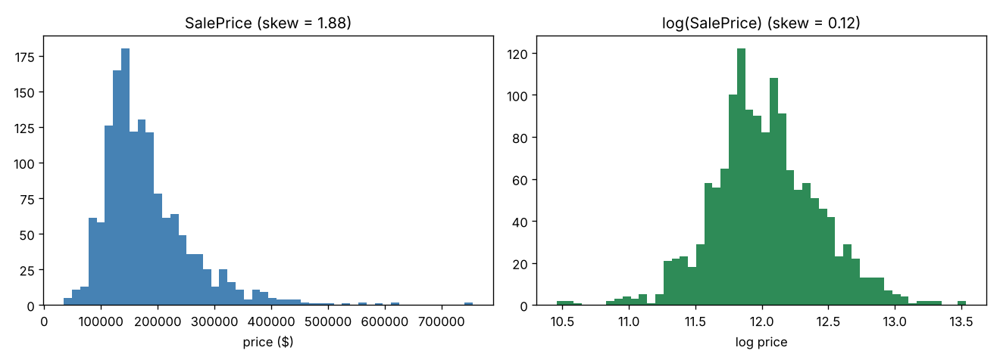
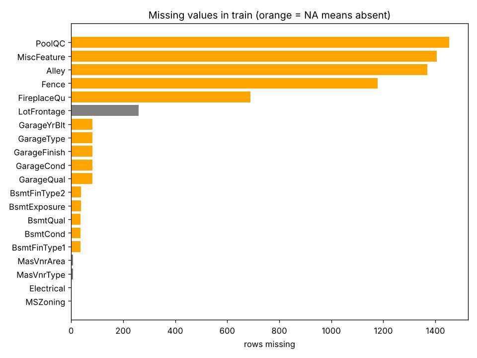
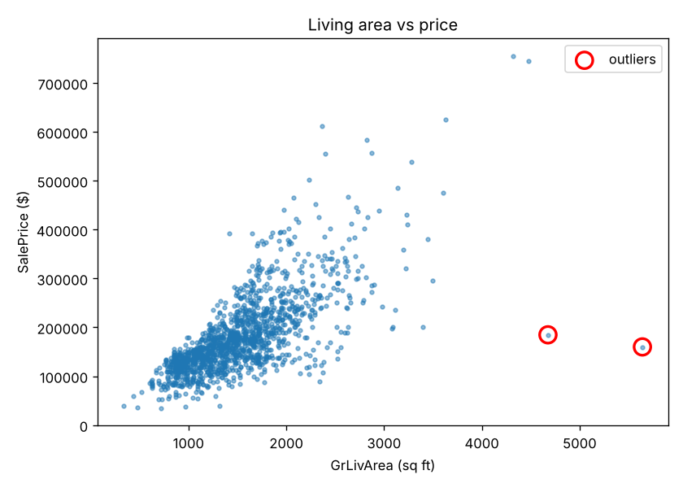
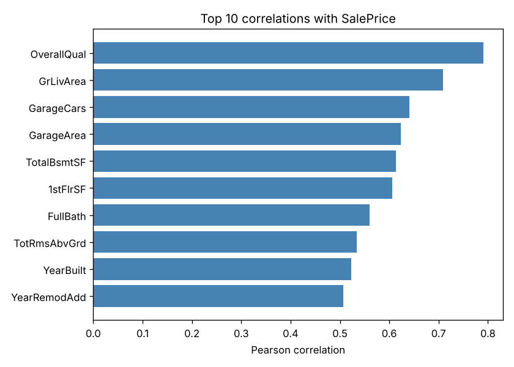

# Part 1 學習筆記：EDA（探索數據）

> EDA 唔係用嚟攞分。佢做嘅係**搵出之後每一步要做咩，同埋點解要咁做**。
> Part 3 每一個 feature engineering step，都可以喺呢度搵到佢嘅源頭，所以報告講「pathway」嗰陣，EDA 就係起點。

> **前置知識（唔識就先睇 Part 0）：** 變數同 function → §1.1、§1.3；`import` 同 f-string → §1.7；DataFrame 同 Series → §3.1；`.loc` 同 boolean mask → §2.3、§3.2；log 同 skew → §5。

> **Step 係咩？** 成本 notebook 將每個實驗編號做 Step 0 至 12，由 Part 2 開始逐步做。Part 1 提到「Step 2」、「Step 6」，只係預告 EDA 嘅發現之後會喺邊一步用到。
>
> **Notebook 標題 vs 筆記編號：** notebook 入面嘅英文小標題（例如「1.4 Outliers」）同呢份筆記嘅章節（例如 §1.5）係兩套編號。筆記講 notebook 嘅格時，會寫「Cell 1」、「Cell 2」……

---

## 1. 概念

### 1.1 呢個比賽考咩

- 有 1460 間知道樓價嘅屋，叫 **train**；另外有 1459 間唔知樓價嘅屋，叫 **test**。要估 test 嗰批嘅樓價。
- 每間屋有 79 個描述欄，例如面積、年份、質素、地段。
- 呢個係 **regression**，因為要估嘅係一個數字，唔係一個類別。

### 1.2 Kaggle 點樣計分：log RMSE

```
score = √( 平均( (log(估計價錢) − log(真實價錢))² ) )
```

直覺上，log 嘅差其實係**百分比誤差**：

- 一間 10 萬嘅屋估成 11 萬，即係估多 10%。
- 一間 100 萬嘅屋估成 110 萬，都係估多 10%。

兩個喺 log 尺度上嘅誤差幾乎一樣。如果唔用 log，第二個錯咗 10 萬，第一個只係錯咗 1 萬，平樓嘅誤差就會被忽略。**結論：分數只理比例，唔理絕對金額。**

### 1.3 Skewness（偏度）

- 數據有一條長尾巴拖向右邊（少數極貴嘅屋），就叫 **right-skewed**。
- skew = 0 代表左右對稱；> 0.75 我哋當係「明顯偏」（Part 3 揀欄取 log 就用呢個門檻）；> 1 就係好偏。
- 我哋嘅 SalePrice skew = **1.88**，取 log 之後得 **0.12**，差唔多完全對稱。

**點解偏斜會影響線性 model？** 線性回歸要減嘅係誤差嘅平方。尾巴嗰幾間貴屋誤差特別大，一平方就更加大，結果成條線都被佢哋拉走。

### 1.4 缺失值有兩種

| 種類 | 例子 | 意思 | 應該點處理 |
|---|---|---|---|
| **NA = 冇呢樣嘢** | PoolQC、GarageType、Fence | 間屋冇泳池、冇車房 | 填一個明確嘅「冇」標籤（Part 3 Step 3） |
| **NA = 唔知** | LotFrontage | 數據收集時漏咗 | 用 median 之類嘅估值填（Part 2 Pipeline） |

呢個分別係從 `data_description.txt` 讀返嚟嘅。**睇數據說明書都係 feature engineering 嘅一部份**，報告值得提。

### 1.5 Outlier（離群值）

有兩間屋大過 4000 平方呎，但只係賣十幾萬。兩間都係 `Partial` sale，即係新樓未起好就賣咗，所以唔跟正常嘅價錢規律。如果 model 硬要遷就佢哋，條線就會整歪，其他 1458 間屋都會受影響。

**重要：** 我哋只係喺 **training** 嗰陣拎走佢哋，計 CV 分數嗰陣佢哋照計。如果連評分都拎走，就變咗呃自己，因為 test 入面可能都有類似嘅屋。呢點 Part 3 會再講。

### 1.6 Correlation（相關係數）

- 數值由 -1 到 1，量度兩個數字**有幾似一條直線咁一齊郁**。
- 局限一：只睇得到直線關係。
- 局限二：睇唔到文字欄（我哋有 43 個文字欄）。
- 所以佢只係一張「快速地圖」，唔應該用嚟決定刪走邊啲 feature。

---

## 2. 逐行解釋

### Cell 1：Setup 同讀數據

```python
from pathlib import Path
```
（`from … import …` → Part 0 §1.7）
`Path` 係處理檔案路徑嘅工具。`Path("a") / "b.csv"` 會自動砌成 `a/b.csv`，Windows、Mac、Linux 都通用。

```python
import numpy as np
import pandas as pd
import matplotlib.pyplot as plt
```
- numpy (`np`) 做數學運算，例如 `np.log`。
- pandas (`pd`) 處理表格（DataFrame）。
- matplotlib (`plt`) 畫圖。

`np`、`pd`、`plt` 呢三個縮寫係業界慣例，人人都咁寫。

```python
CANDIDATES = [Path("/kaggle/input/house-prices-advanced-regression-techniques"),
              *sorted(path.parent for path in Path("/kaggle/input").glob("**/train.csv")),
              Path("../house-prices-advanced-regression-techniques"),
              Path("house-prices-advanced-regression-techniques")]
```
- `CANDIDATES` 係一個 list（→ Part 0 §1.2），入面放咗幾個可能搵到 data 嘅位置。
- 第 1 個：Kaggle 比賽 data 嘅標準位置。
- 第 2 行：**後備**。`glob("**/train.csv")` 會喺 `/kaggle/input` 入面所有 folder（包括 folder 入面嘅 folder）搵叫 `train.csv` 嘅檔案，`.parent` 攞佢所在嘅 folder。萬一 Kaggle 將 data 放咗喺另一個名嘅 folder，都搵得到。前面個 `*` 嘅意思係「將搵到嘅每一個都逐個放入呢個 list」。喺你自己部電腦冇 `/kaggle/input`，呢行就乜都唔加。
- 最後兩個：喺你自己部電腦（本地）嘅位置。

```python
DATA_DIR = next((path for path in CANDIDATES if (path / "train.csv").exists()), None)
if DATA_DIR is None:
    raise FileNotFoundError("Could not find train.csv. Looked in: " + ...)
```
- `(path for path in CANDIDATES if (path / "train.csv").exists())`：逐個位置去試，只保留真係有 `train.csv` 嘅，即係 generator expression（→ Part 0 §1.8）。
- `next(…, None)`：攞第一個搵到嘅；一個都搵唔到就俾 `None`。
- `raise FileNotFoundError(...)`：搵唔到就即刻停低，並且印出一句清楚嘅錯誤訊息，講明搵過邊幾個位置、喺 Kaggle 要撳「Add Input」掛 data。咁你就唔會見到一個睇唔明嘅錯誤。
- **冇咗呢幾行會點：** 同一本 notebook 唔可以喺 Kaggle 同你部電腦都跑得到。

```python
ON_KAGGLE = Path("/kaggle/working").exists()
OUT_DIR = Path("/kaggle/working") if ON_KAGGLE else DATA_DIR.parent / "v2" / "results"
(OUT_DIR / "figures").mkdir(parents=True, exist_ok=True)
```
- `ON_KAGGLE`：有 `/kaggle/working` 呢個 folder，就代表喺 Kaggle 度跑緊。
- Kaggle 只准寫檔案入 `/kaggle/working`，所以 output 要放嗰度。
- 本地就放入 repo 嘅 `v2/results`。用 `DATA_DIR.parent`（data folder 嘅上一層，即係 repo）嚟定位，咁無論你喺邊個 folder 開 notebook，output 都會去同一個地方。
- 一行 if（`A if 條件 else B`）→ Part 0 §1.8。
- `mkdir` 開 folder。`parents=True` 代表連上層 folder 一齊開；`exist_ok=True` 代表已經有就唔好報錯。

（`def` 定義 function，`return` 交返結果 → Part 0 §1.3。寫成 function 係因為要讀 3 個檔案，設定要完全一樣。）

```python
def read_csv(name):
    return pd.read_csv(DATA_DIR / name, keep_default_na=False, na_values=["NA", ""])
```
**呢行係成個 Part 最容易中伏嘅地方。**

- pandas 預設會將 `"None"` 呢個字當成缺失值。
- 但喺呢份數據入面，`MasVnrType = "None"` 意思係「冇石材外牆」，係一個真嘅類別（有 864 間屋係咁）。
- `keep_default_na=False` 叫 pandas 唔好用佢預設嗰張「當成缺失」嘅清單。
- `na_values=["NA", ""]` 就話佢知，只有 `NA` 同空格先算缺失。
- **冇咗會點：** 864 個真實資料會被當成「唔知」，間接整壞 model。

**親眼比較兩種讀法：**

```python
default = pd.read_csv("../house-prices-advanced-regression-techniques/train.csv")   # pandas 預設讀法
print("pandas default: MasVnrType missing =", default["MasVnrType"].isna().sum())
print("our way:        MasVnrType missing =", train["MasVnrType"].isna().sum())
train["MasVnrType"].value_counts(dropna=False)
```

跑出嚟會見到：

```text
pandas default: MasVnrType missing = 872
our way:        MasVnrType missing = 8
MasVnrType
None       864
BrkFace    445
Stone      128
BrkCmn      15
NaN          8
Name: count, dtype: int64
```

**點睇：** 預設讀法會話有 872 間屋「唔知」外牆類型；我哋嘅讀法只有 8 間真係唔知，其餘 864 間其實係「None（冇石材外牆）」。`value_counts(dropna=False)` 嘅 `dropna=False` 即係連 NaN 都一齊數。

```python
train = read_csv("train.csv")
test = read_csv("test.csv")
sample = read_csv("sample_submission.csv")
print("train:", train.shape, " test:", test.shape)
```

跑出嚟會見到：

```text
train: (1460, 81)  test: (1459, 80)
```
- 讀三個檔案。`sample` 係 Kaggle 俾嘅提交格式範本，之後用嚟對齊 Id。
- `.shape` 回傳（行數, 欄數）。結果係 train (1460, 81)，test (1459, 80)。test 少一欄，因為冇 SalePrice。

### Cell 2：First look

```python
print(train.dtypes.value_counts())
train.head()
```

跑出嚟會見到：

```text
object     43
int64      35
float64     3
Name: count, dtype: int64

   Id  MSSubClass MSZoning  LotFrontage  LotArea Street Alley LotShape  ...
0   1          60       RL         65.0     8450   Pave   NaN      Reg   ...
1   2          20       RL         80.0     9600   Pave   NaN      Reg   ...
2   3          60       RL         68.0    11250   Pave   NaN      IR1   ...
3   4          70       RL         60.0     9550   Pave   NaN      IR1   ...
4   5          60       RL         84.0    14260   Pave   NaN      IR1   ...
[5 rows x 81 columns]
```

（表太闊，`...` 代表中間啲欄被省略咗。留意 Alley 一欄全部係 NaN：呢 5 間屋都冇後巷，正正係 Part 1 §1.4 講嘅「NA = 冇呢樣嘢」。）
- 數下每種資料類型有幾多欄：object（文字）43 欄、int64 35 欄、float64 3 欄。
- `head()` 顯示頭 5 行。
- 一個 cell 最後嗰行嘅結果，Jupyter 會自動顯示出嚟，所以唔使寫 `print`。

### Cell 3：SalePrice 分佈圖

```python
fig, axes = plt.subplots(1, 2, figsize=(11, 4))
```
開一幅圖，入面有 1 行 2 格（`axes[0]` 同 `axes[1]`），闊 11 吋、高 4 吋。

```python
axes[0].hist(train.SalePrice, bins=50, color="steelblue")
axes[0].set(title=f"SalePrice (skew = {train.SalePrice.skew():.2f})", xlabel="price ($)")
```
- `hist` 畫直方圖，`bins=50` 即係將價錢切成 50 段。
- `f"...{...:.2f}"` 係 f-string，會將計出嚟嘅 skew 塞入標題，`:.2f` 代表顯示 2 個小數位。

```python
axes[1].hist(np.log(train.SalePrice), bins=50, color="seagreen")
```
同一樣嘢，不過先取 log 再畫。兩幅並排放，一眼就睇到取 log 前後嘅分別。

```python
fig.tight_layout()
fig.savefig(OUT_DIR / "figures" / "01_saleprice_distribution.png", dpi=120)
plt.show()
```

跑出嚟嘅圖：



左邊原價：一大堆屋擠喺左邊，條尾巴拖到 75 萬。右邊 log 價錢：差唔多左右對稱，好似一個鐘。
- `tight_layout` 自動調整，費事啲字重疊。
- `savefig` 存圖，之後放入報告同 slides。
- `show` 喺 notebook 入面顯示幅圖。

### Cell 4：缺失值

```python
ABSENT_MEANING = ["PoolQC", "MiscFeature", ...]
```
人手列出「NA = 冇」嘅欄。呢張清單係**睇 `data_description.txt` 得返嚟嘅**，唔係計出嚟。

```python
missing = pd.DataFrame({"train": train.drop(columns="SalePrice").isna().sum(),
                        "test": test.isna().sum()})
```
- `{"train": ..., "test": ...}` 係一個 dict（→ Part 0 §1.2）：key 會變成欄名，value 係嗰欄嘅內容。
- `isna()` 將每一格變成 True（缺失）或者 False。
- `.sum()` 將每欄嘅 True 數埋，即係每欄缺幾多格。
- train 同 test 分開兩欄數，方便比較。

**先搞清楚 `missing` 係一張咩表：** `train.isna().sum()` 嘅結果係一條 Series，佢嘅**行名（index）係 train 嘅欄名**，值係嗰欄缺幾多格（→ Part 0 §3.1）。逐步睇：

```python
step1 = train.drop(columns="SalePrice").isna().sum()
print(step1.shape)
step1.head(4)
```

跑出嚟會見到：

```text
(80,)
Id               0
MSSubClass       0
MSZoning         0
LotFrontage    259
dtype: int64
```

**點睇：** 第一步得出一條有 80 個值嘅 Series：每個欄一個數，即係嗰欄缺幾多格。頭 4 個：Id、MSSubClass、MSZoning 冇缺，LotFrontage 缺 259。

```python
missing = pd.DataFrame({"train": train.drop(columns="SalePrice").isna().sum(),
                        "test": test.isna().sum()})
missing.loc[["PoolQC", "LotFrontage", "Street"]]
```

跑出嚟會見到：

```text
             train  test
PoolQC        1453  1456
LotFrontage    259   227
Street           0     0
```

**點睇：** 兩條 Series 並排，變成一張表：每一行代表 train 嘅**一個欄**，train 欄係 train 缺幾多，test 欄係 test 缺幾多。Street 兩邊都係 0，所以下一步會被過濾走。

`missing.index` 就係呢啲欄名（"PoolQC"、"LotFrontage"……）。

```python
missing = missing[(missing.train + missing.test) > 0]
```
只留低有缺失嘅欄（train 加 test 嘅缺失數大過 0）。

```python
missing["kind"] = np.where(missing.index.isin(ABSENT_MEANING), "NA = absent", "truly unknown")
```
- `missing.index.isin(ABSENT_MEANING)`：每個欄名係咪喺「NA = 冇」嗰張清單入面，得出一串 True/False。
- `np.where(條件, A, B)`：條件成立就填 A，唔成立就填 B。用嚟幫每欄標記係邊種缺失。

```python
missing = missing.sort_values("train", ascending=False)
```
按 train 缺失數**由多到少**排好（→ Part 0 §3.3）。之後 `head(20)` 先會係「缺最多嗰 20 欄」。

```python
print("Columns missing only in test:", missing.index[missing.train.eq(0)].tolist())
```

跑出嚟會見到：

```text
Columns missing only in test: ['MSZoning', 'BsmtFinSF2', 'BsmtUnfSF', 'Utilities', 'Exterior2nd',
'Exterior1st', 'BsmtFinSF1', 'TotalBsmtSF', 'BsmtHalfBath', 'KitchenQual', 'Functional',
'BsmtFullBath', 'GarageArea', 'GarageCars', 'SaleType']
```
- `missing.train.eq(0)`：train 缺失數係咪等於 0（`.eq(0)` 即係 `== 0`）。
- `missing.index[...]`：用呢串 True/False 揀出對應嘅欄名。
- `.tolist()`：變成普通 list，印出嚟易睇啲。
- 結果：train 冇缺、但 test 有缺嘅欄有 15 個，例如 `MSZoning`、`GarageCars`。
- **點解重要：** model 喺 training 時從未見過呢啲欄有缺失。如果唔處理，到 test 先會爆。Part 2 嘅 Pipeline 會負責填佢哋。

```python
top = missing.head(20).iloc[::-1]
colors = np.where(top.kind.eq("NA = absent"), "orange", "gray")
ax.barh(top.index, top.train, color=colors)
```

跑出嚟嘅圖：



跑出嚟會見到：

```text
              train  test           kind
PoolQC         1453  1456    NA = absent
MiscFeature    1406  1408    NA = absent
Alley          1369  1352    NA = absent
Fence          1179  1169    NA = absent
FireplaceQu     690   730    NA = absent
LotFrontage     259   227  truly unknown
GarageYrBlt      81    78    NA = absent
GarageType       81    76    NA = absent
...
MSZoning          0     4  truly unknown
GarageCars        0     1  truly unknown
SaleType          0     1  truly unknown
```

（cell 最後一行 `missing` 會顯示成張表，呢度只列部份。）每一行係 train 嘅一個欄：train 欄係 train 缺幾多格，test 欄係 test 缺幾多格，kind 係我哋標記嘅缺失種類。
- 揀缺失最多嘅 20 欄。`iloc[::-1]` 將次序倒轉（slicing → Part 0 §1.2），咁最多嗰欄就會喺橫向棒形圖嘅最上面，因為 `barh` 係由下而上畫。
- 橙色代表「NA = 冇」，灰色代表「唔知」。
- 呢度用 `fig, ax = plt.subplots(...)`（得一格圖，所以叫 `ax`），Cell 3 就用 `axes`（兩格）。Figure 同 Axes 嘅分別 → Part 0 §6。

### Cell 5：Outlier

```python
outlier = (train.GrLivArea > 4000) & (train.SalePrice < 300000)
```
- 呢行會得出一條 True/False 嘅 Series，叫 boolean mask（→ Part 0 §2.3）：1460 個值，outlier 係 True。
- 兩個條件同時成立先算 outlier。`&` 係「同埋」；pandas 要用 `&`，唔可以用 `and`，而且每個條件要加括號。
- **點解唔係只用 `> 4000`？** 因為有兩間大屋賣到 70 幾萬，佢哋完全跟正常規律（大屋貴價），唔應該拎走。

```python
ax.scatter(train.GrLivArea, train.SalePrice, s=8, alpha=0.5)
ax.scatter(train.GrLivArea[outlier], train.SalePrice[outlier], s=150,
           facecolors="none", edgecolors="red", linewidths=2, label="outliers")
```
- 第一行畫全部點。`alpha=0.5` 係半透明，點重疊嘅地方會深色啲。（呢個 `alpha` 係畫圖嘅透明度，同 Ridge 嘅 alpha 冇關係。）
- 第二行喺 outlier 上面再畫一個空心紅圈。`train.GrLivArea[outlier]` 用 boolean mask 只揀 outlier 嗰兩間（→ Part 0 §2.3）。
- `label="outliers"` 加 `ax.legend()`：喺圖嘅角落顯示「紅圈 = outliers」嘅圖例。`ax.set(title=..., xlabel=..., ylabel=...)` 設標題同軸名（→ Part 0 §6）。

```python
train.loc[outlier, ["Id", "GrLivArea", "SalePrice", "OverallQual", "SaleCondition"]]
```

跑出嚟嘅圖：



跑出嚟會見到：

```text
        Id  GrLivArea  SalePrice  OverallQual SaleCondition
523    524       4676     184750           10       Partial
1298  1299       5642     160000           10       Partial
```

左邊 523、1298 係 index（行號，由 0 數起），所以同 Id（由 1 數起）差 1。兩間都係最高質素（10 分）、面積最大，但賣得好平，而且都係 Partial sale。
- 用 `.loc[邊啲行, 邊啲欄]` 攞出嗰兩間屋嘅資料（→ Part 0 §3.2）。
- **注意：** 呢個 `outlier` 變數之後 Part 2 嘅 `cv_evaluate` 會再用（Step 6 拎走 outlier 嗰陣）。佢係用**原始數據**計嘅，所以之後就算面積取咗 log，佢都唔會變。
- 會見到 `SaleCondition = Partial`，呢個就係拎走佢哋嘅**理由**，唔係淨係因為佢哋「睇落怪」。

### Cell 6：相關係數

```python
correlations = (train.select_dtypes("number").drop(columns="Id")
                .corr()["SalePrice"].drop("SalePrice").sort_values())
```
由左至右讀：

1. 只揀數字欄；
2. 拎走 Id，因為 Id 只係編號，冇意思；
3. `.corr()` 計出所有欄兩兩之間嘅相關；
4. `["SalePrice"]`：只攞 SalePrice 嗰一**欄**，即係「每個欄同 SalePrice 嘅相關」；
5. 拎走 SalePrice 自己（自己同自己一定係 1）；
6. 由細到大排好。

**逐步睇住佢變：**

```python
numeric = train.select_dtypes("number").drop(columns="Id")
print("step 1-2, numeric columns only:", numeric.shape)
corr_table = numeric.corr()
print("step 3, correlation table:", corr_table.shape)
corr_table.iloc[:3, :3].round(2)
```

跑出嚟會見到：

```text
step 1-2, numeric columns only: (1460, 37)
step 3, correlation table: (37, 37)
             MSSubClass  LotFrontage  LotArea
MSSubClass         1.00        -0.39    -0.14
LotFrontage       -0.39         1.00     0.43
LotArea           -0.14         0.43     1.00
```

**點睇：** 剩低 37 個數字欄；`.corr()` 計出一張 37 × 37 嘅大表，每一格係兩個欄之間嘅相關。呢度只顯示左上角 3 × 3：對角線一定係 1（自己同自己）。

```python
correlations = corr_table["SalePrice"].drop("SalePrice").sort_values()
print("step 4-6:", correlations.shape)
print(correlations.head(3).round(3))
print(correlations.tail(3).round(3))
```

跑出嚟會見到：

```text
step 4-6: (36,)
KitchenAbvGr    -0.136
EnclosedPorch   -0.129
MSSubClass      -0.084
Name: SalePrice, dtype: float64
GarageCars     0.640
GrLivArea      0.709
OverallQual    0.791
Name: SalePrice, dtype: float64
```

**點睇：** 攞出 SalePrice 嗰一欄、拎走佢自己，剩低 36 個數，再由細到大排。最細（`head`）嘅係負相關：數值越大、樓價略低；最大（`tail`）嘅就係同樓價最一齊升嘅三個欄。

```python
top10 = correlations.tail(10)
```
因為已經由細到大排好，最後 10 個（`.tail(10)`）就係相關最高嘅 10 個。

```python
ax.barh(top10.index, top10.values, color="steelblue")
```
畫橫棒圖：y 軸係欄名（`top10.index`），棒嘅長度係相關係數（`top10.values`）。

```python
top10.iloc[::-1].round(3)
```

跑出嚟嘅圖：



跑出嚟會見到：

```text
OverallQual     0.791
GrLivArea       0.709
GarageCars      0.640
GarageArea      0.623
TotalBsmtSF     0.614
1stFlrSF        0.606
FullBath        0.561
TotRmsAbvGrd    0.534
YearBuilt       0.523
YearRemodAdd    0.507
Name: SalePrice, dtype: float64
```
倒轉次序（最高嘅排第一），取 3 個小數位，顯示成表。

---

## 3. 點睇結果

| 結果 | 代表咩 |
|---|---|
| SalePrice skew 1.88 → log 後 0.12 | 預測 log 價錢會令線性 model 舒服好多（Step 2） |
| PoolQC 缺 1453/1460 | 唔係數據差，而係 99.5% 嘅屋都冇泳池 |
| LotFrontage 缺 259 | 真係唔知，要估值填返 |
| 15 欄只喺 test 有缺失 | Pipeline 一定要識處理「未見過嘅缺失」 |
| 2 個 outlier（Id 524、1299） | Step 6 測試拎走佢哋 |
| OverallQual 0.79、GrLivArea 0.71 | 質素同面積主導價錢，所以 Step 4 要整「總面積」 |

最尾嗰個 markdown 表（「What EDA tells us to do next」）將每個發現連去之後嘅 step。**報告講 pathway 嗰陣，可以直接用呢張表做骨幹。**

---

## 4. 講師可能會問

**Q：點解要預測 log 價錢，唔直接預測價錢？**
A：有兩個原因。第一，Kaggle 本身就係喺 log 尺度計分，喺同一個尺度訓練先最直接。第二，樓價係 right-skewed（1.88），取 log 之後接近對稱（0.12），線性 model 就唔會被幾間貴屋拉走。Step 2 會用 CV 分數證明呢點。

**Q：點解唔將缺失太多嘅欄（例如 PoolQC）直接刪走？**
A：因為 PoolQC 嘅 NA 唔係「唔知」，而係「冇泳池」，本身就係資訊。刪走就會連「有冇泳池」呢個資訊一齊冇咗。正確做法係將 NA 改做一個明確嘅「NoPool」標籤。

**Q：拎走 outlier 算唔算作弊？**
A：唔算，前提係三點：(1) 有理由，嗰兩間係 Partial sale，唔跟正常市場規律；(2) 只喺 training 拎走，計分時照計；(3) 用 CV 證明拎走之後真係有幫助（Step 6）。如果連評分都拎走，先係呃自己。

**Q：Correlation 低嘅欄係咪可以刪走？**
A：唔應該。Correlation 只睇到直線關係，亦睇唔到文字欄。例如 Neighborhood（地區）好影響樓價，但佢係文字欄，correlation 根本計唔到。

**Q：點解讀 CSV 要加 `keep_default_na=False`？**
A：因為 pandas 預設會將 `"None"` 當成缺失，但喺呢份數據入面，`"None"` 係一個真實類別（冇石材外牆，有 864 間屋）。唔加呢個設定，就會誤刪真實資訊。

---

## 有用嘅課堂連結（你有課程目錄之後我再補）

- Data preprocessing：缺失值處理、outlier
- Data exploration：分佈、skewness、correlation
